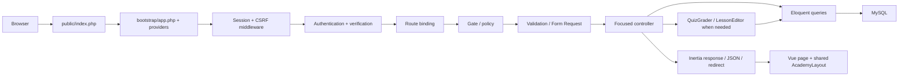

# Architecture

Laravel Mastery Academy is a local Laravel 12 application with Vue 3 Composition API pages, Inertia 3, Tailwind 4, Vite 8, MySQL, and official Breeze authentication scaffolding. PHP 8.2 is the installed compatibility baseline. Dependency locks record the resolved versions; run `composer show` and `node scripts/npm.cjs ls --depth=0` for exact installed versions.

## Request lifecycle

`routes/web.php` keeps learning routes under `auth` and `verified`. Admin routes also require `can:manage-content`; lesson create/update/preview use `LessonPolicy`. Profile routes remain accessible to unverified users so they can correct an email address.

## Boundaries

- Controllers own HTTP responsibilities. Simple progress, bookmark, and goal operations use user-owned relationships directly; a redundant repository layer is intentionally omitted.
- `QuizGrader` validates complete question/option membership and writes an attempt plus answers transactionally. It locks the quiz parent to coordinate with the content editor.
- `LessonEditor` saves metadata and normalized child records in one transaction. It locks the lesson and existing quiz. Attempted quizzes cannot be revised or removed; create a new lesson for a new assessment version. Text and other lesson content can still be edited.
- Questions and options hide explanation/correctness fields during ordinary serialization. The quiz endpoint returns feedback only after a valid submission. Admin editing deliberately serializes the full answer configuration behind authorization.
- `Lesson::published()` checks both lesson and module publication. Library, dashboard, progress, bookmarks, and history use that boundary. Authorized admins may preview drafts without creating learner progress.
- Small structured values such as objectives and project milestones use JSON. Sections, code, exercises, quiz questions, and answers are separate records.
- Frontend components render prose and code as data. `CodePlayground` only inserts highlight.js-generated markup. Browser-edited PHP is never sent to an execution endpoint.

## Frontend

`AcademyLayout` supplies responsive/collapsible navigation, global search, keyboard search focus, theme selection, account links, and flash messages. Page components own workflows. Reusable components handle icons, lesson cards, pagination, code examples, and quizzes. Theme preference is browser-local; learning records are server-persisted and user-scoped.

Inertia 3 uses a JSON bootstrap script for initial page data and asset version headers for subsequent navigation. `scripts/http-smoke.mjs` exercises that protocol over actual HTTP, including session cookies and CSRF.

## Query behavior and trade-offs

The library is paginated and eager loads module/tags; completion/bookmark flags use existence subqueries. Dashboard/history relationships are eager loaded with bounded recent lists. Development enables lazy-loading violations. A regression test checks query growth from one to twelve library rows. This is evidence about query shape, not a production load benchmark.

Search uses escaped, bound LIKE parameters across title, summary, sections, code, and tags. This is useful for the starter course; full-text search and real production load testing are future work. Admin module/lesson ordering uses explicit positions and stable ID tie-breakers.

No external payment, mail delivery, Redis, broadcasting, PDF, or ERP service is required by the academy. Their lessons label snippets and project blueprints clearly. See [curriculum scope](CURRICULUM_ROADMAP.md) for unfinished requested course depth.
