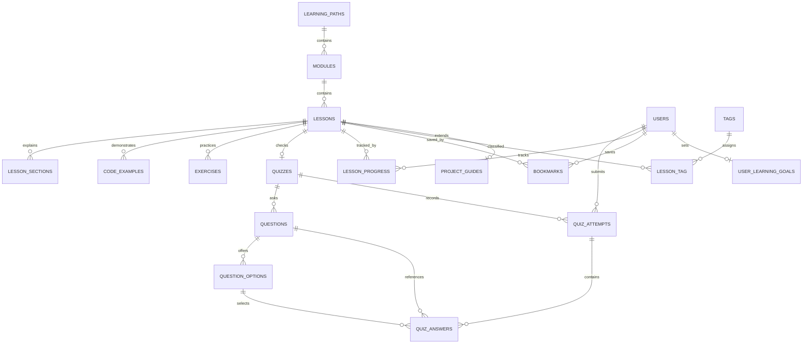

# Database design

Development uses the dedicated schema `laravel_mastery_academy` on the installed MariaDB 10.4.28 service, with Laravel's `mariadb` driver. It is MySQL-compatible but is not MySQL 8; `.env.example` targets MySQL for clean installations. The installed service is verified by migrations, seeding, and HTTP persistence checks. Default tests force in-memory SQLite and do not touch development records. `php artisan academy:status` prints the actual server version and course counts without credentials.

## Constraints and retention

| Table | Important rule |
| --- | --- |
| users | Email unique; `is_admin` defaults false and is excluded from fillable |
| learning_paths/modules/lessons | Unique slugs; parents restrict deletion |
| lessons | Index on module, publication, and position |
| lesson_sections/code_examples/exercises | Owned by lesson; cascade on lesson deletion |
| quizzes | At most one per lesson |
| quiz_attempts | Per-user history; indexed by user and creation time |
| quiz_answers | Unique attempt/question; historical question/option references restrict deletion |
| lesson_progress | Unique user/lesson, indexed user/completed_at |
| bookmarks | Unique user/lesson |
| user_learning_goals | One per user; separate daily and weekly lesson counts |
| tags/lesson_tag | Unique tag names and unique lesson/tag pair; tag removal detaches assignments |
| project_guides | One optional guide per lesson; structured milestone/acceptance arrays |

Unpublishing preserves progress and historical attempts; learner discovery excludes unpublished content. Content deletion is not exposed in the admin UI. Attempted quizzes are immutable through the editor so historical scores remain interpretable. Account deletion removes its progress, bookmarks, goals, attempts, and answers through owned-record cascades.

`CurriculumSeeder` inserts missing records by stable slug and preserves existing editorial changes. Re-seeding does not update existing lessons. Renaming a seeded slug and then re-seeding can reinsert the original lesson; use a content migration for a deliberate catalog-wide rename. Do not use `migrate:fresh` against data you want to preserve.

`UserFactory`, `ModuleFactory`, and `LessonFactory` support independent test fixtures. Nested quiz fixtures are created explicitly in tests to make question/option ownership visible. Migrations provide schema compatibility; MySQL-specific lock/concurrency behavior needs dedicated tests before adapting examples to a real payment or inventory system.
