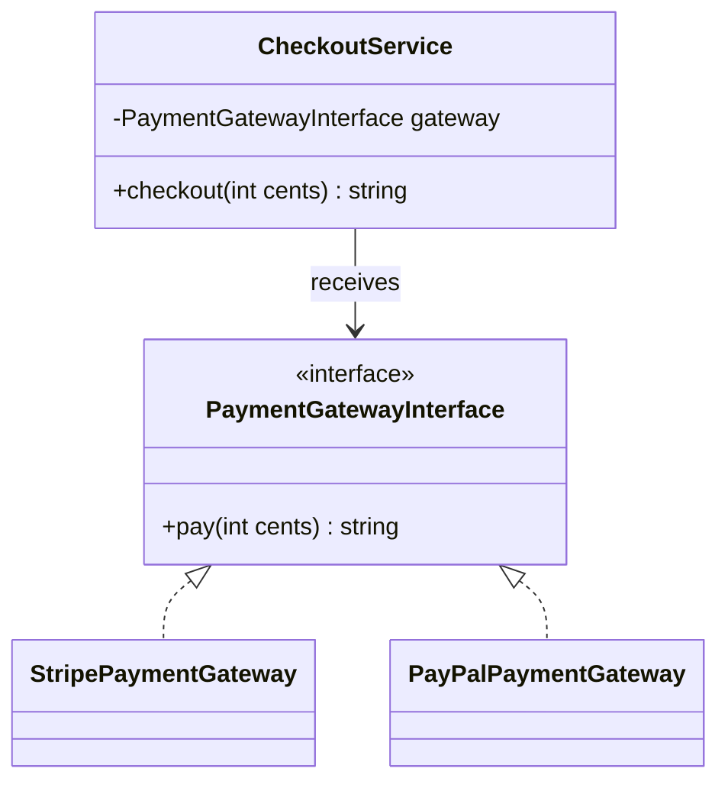

# OOP course guide

The eleven OOP lessons cover classes/objects, constructors and named arguments, visibility/encapsulation, readonly data, inheritance/overriding, abstract classes, interfaces/injection, traits/conflicts, polymorphism, composition/delegation, static/late binding, values/entities/aggregates, magic methods, cloning, and anonymous classes. Several related topics share one lesson; dedicated advanced-depth lessons remain on the roadmap.

## Core example relationships

The checkout depends on a capability, so provider choice belongs to construction/configuration. Implementations in the lessons simulate results; no charge is performed. Laravel provider binding is a separate framework technique built on PHP interfaces and object construction.

| Need | Useful tool | Main trade-off |
| --- | --- | --- |
| Enforce a balance invariant | Private state plus withdraw/deposit behavior | A careless setter can still bypass meaning |
| Share a stable algorithm skeleton | Abstract class/template method | One parent and stronger inheritance coupling |
| Swap a provider or fake | Interface plus injection | Contracts need behavioral semantics, not just signatures |
| Reuse cohesive mechanics | Trait | Hidden property/lifecycle dependencies and conflict handling |
| Combine independent behavior | Composition/delegation | More collaborators must still form a readable use case |
| Express amount/currency | Immutable value object | Readonly is shallow; currency scale/rounding remain explicit |
| Represent continuing identity | Entity | Attribute equality is not identity |

Pay attention to language details: `self::` resolves in the defining scope while `static::` preserves the called class; clone is shallow unless nested state is copied; PHP magic overloading is not Java-style repeated method signatures; a destructor is not a reliable place for a business side effect. Behavioral substitutability still matters when PHP accepts a compatible signature.

Read the PHP fundamentals first, then trace every standalone example. Modify it locally in the playground, predict the new outcome, and run trusted source in your own CLI if needed. The browser's documented output intentionally remains tied to the original example. Exercises include exception/invariant tests, fake collaborators, and explicit persistence/concurrency caveats.
