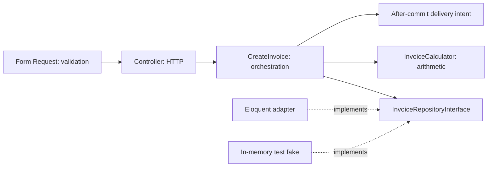

# SOLID course guide

All five principles have dedicated starter lessons with a concrete example, explanation, analogy, bad-practice discussion, Laravel application, exercise, interview answer, and quiz. Project A combines the five in a simulated checkout design. Dedicated runnable Laravel examples/tests for every proposed refactoring remain future curriculum work.

| Principle | Question | Example boundary | Misuse to avoid |
| --- | --- | --- | --- |
| SRP | What coherent reason makes this class change? | InvoiceCalculator vs PDF rendering and delivery | One class per statement |
| OCP | Where should new behavior be added? | Discount strategies | A plugin registry without a real variation point |
| LSP | Can every implementation honor this promise? | Exporters accept documented empty input | Signature compatibility without behavioral tests |
| ISP | What capability does this client need? | ReportExporter separate from ReportSender | Dummy unsupported methods or mechanical one-method splitting |
| DIP | Does policy depend on a meaningful abstraction? | InvoiceService → repository contract ← Eloquent adapter | Repository wrappers for every simple CRUD operation |

Dependency injection is how a collaborator arrives. Dependency inversion concerns source dependency direction. Injecting a concrete Eloquent repository is injection, but policy still knows that adapter. Introduce an interface when it expresses a useful boundary and define what missing IDs, currency units, and failures mean.

Test at several boundaries: pure arithmetic unit tests, shared contract tests across implementations, feature tests for permission/validation/transaction behavior, and adapter tests for actual persistence. Do not mistake a mocked successful call for proof that a production provider works. The academy itself demonstrates pragmatic boundaries in `QuizGrader`, `LessonEditor`, policies, and focused controllers without adding an unnecessary repository for each learning model.
